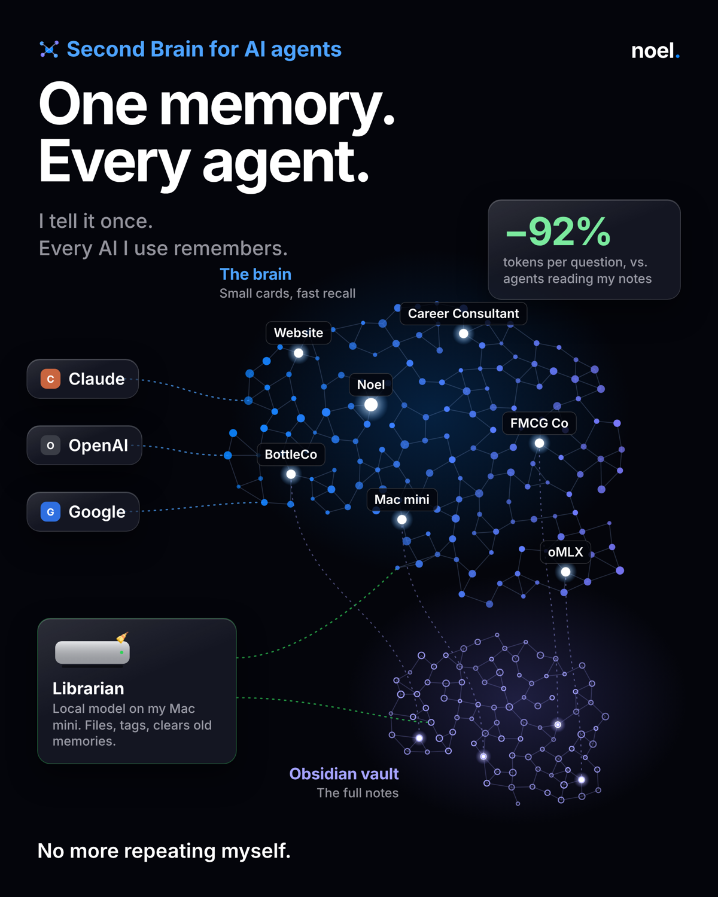
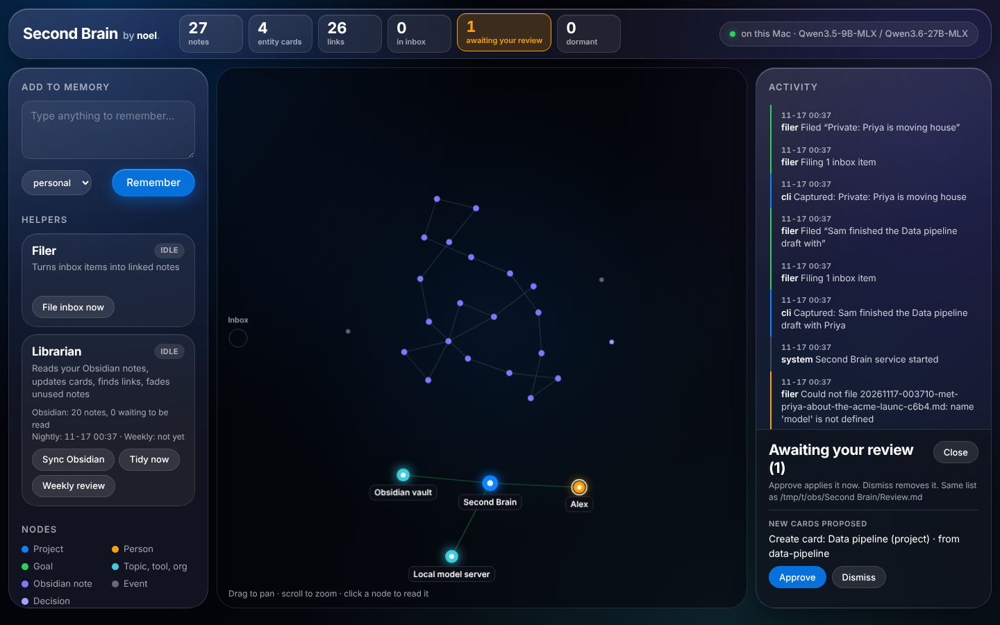

# Second Brain by noel.

One shared memory for Claude and every other AI agent on your Mac.

<p align="center"></p>

Your Obsidian vault holds the details. A helper model keeps a set of short cards that point into it. Any agent asks the cards first, then opens only the note it needs.

- **You stop repeating yourself.** Name a project and the agent gets what it is, what was done, and where the details are.
- **Agents spend fewer tokens.** A lookup is capped at about 500 tokens. The start-of-task brief is about 400. On my 100-note vault, answering 18 real questions took about 1,500 tokens per correct answer, against about 10,500 for an agent that greps and reads.¹
- **Your notes stay yours.** They stay as plain Markdown in Obsidian. The helpers read them and never change them.
- **Runs with or without a local model.** Use a local model, your Claude Code sign-in, your own Anthropic API key, or rules only.

> Status: version 1.3. Built and run on one Mac mini (M4, 24GB) with oMLX. macOS only for now. Treat it as a working personal tool, not a product.

## How it works

```
You, Claude, any agent
        │  brief · recall · expand · log · write · sync   (MCP)
        ▼
  Second Brain  ──────────►  Obsidian vault
  cards + index              the details, source of truth
        ▲
        │  reads what changed, updates cards, finds links
  Helpers (filer, librarian): local model, Claude Code, API key, or rules
```

| Part | What it does | Where it lives |
|---|---|---|
| **Obsidian vault** | Holds every detail. Source of truth. | Your vault |
| **Cards** | One short card per person, project, org, tool or goal: what it is now, key facts, a timeline. | `~/SecondBrain/vault` |
| **Index** | Search and the link graph. Disposable: rebuilt from the notes at any time. | `~/SecondBrain/index.db` |
| **Filer** | Turns "remember this" into a dated note in the vault, linked to the cards it names. | Helper model |
| **Librarian** | Reads notes that changed, updates cards, fades unused ones, proposes merges and deletions. | Helper model |
| **Gateway** | Six tools any MCP client can call. | `brain mcp` |
| **Dashboard** | A live graph. Watch notes arrive, cards update and agents recall. | `localhost:8765` |


*The dashboard, shown on test data.*

## Three rules

1. **Notes are the truth.** Cards and the index are derived. Delete them and they rebuild.
2. **The model never guesses.** Every line the helper model writes is checked against the source text. If a name or number is not in the source, the line is dropped. The model cannot add links; a note links only to cards it names.
3. **Nothing is deleted without you.** New cards, merges and deletions wait as tick-boxes in `Second Brain/Review.md`. The helpers write only inside the `Second Brain` folder of your vault.

## Install

You need a Mac, Python 3.9 or newer and an Obsidian vault. A model is optional: see [Pick the helpers' model](#pick-the-helpers-model).

1. Download or clone this repo.
2. Run the installer:
   ```bash
   bash install.sh --obsidian "/path/to/your/vault" --name "Your name"
   ```
   Leave out `--obsidian` and it looks for a single vault in iCloud, then asks. Add `--model claude-code` (or `anthropic`, `local`, `none`) to choose the helpers' model now; the default `auto` picks one for you.
3. Run `brain doctor`. It checks Python, the vault and the model. If your vault is in iCloud, it names the one file macOS needs in Full Disk Access.
4. Quit and reopen Claude so it loads the memory tools.

The installer puts the app in `~/SecondBrain`, starts a background service, and opens the dashboard. It also:
- connects Claude Code and Claude desktop to the gateway (the desktop config is backed up first)
- adds a short memory rule to `~/.claude/CLAUDE.md`
- adds one PATH line to `~/.zshrc`
- copies the `remember` skill to `~/.claude/skills`

**Other MCP clients:** command `~/SecondBrain/app/bin/brain`, args `mcp --agent <name>`.

**If a local model is not found:** put your server's address and key in `~/SecondBrain/config.json` under `llm`, then run `brain restart`. The installer reads the oMLX key from `~/.omlx/settings.json` when it can. Or switch to Claude Code: `brain model claude-code`.

## Use it

| You want to | Do this |
|---|---|
| Save something | Tell Claude "remember this", type in the dashboard, or `brain add "text"` |
| Save from your phone | Drop a note in `Second Brain/Inbox` in Obsidian |
| See what an agent would get | `brain recall "acme launch"` |
| Read one note or section | `brain expand <id>` or `brain expand "<id>#Section"` |
| Catch up after editing the vault | `brain sync` (it also happens by itself within about 10 seconds) |
| Approve cards, merges, deletions | Tick boxes in `Second Brain/Review.md` |
| Watch it work | `brain open` |

### The six tools

| Tool | Use |
|---|---|
| `brief` | Core context at the start of a task. About 400 tokens. |
| `recall` | Name the people, projects or topics. Returns their cards and the vault paths of the notes with the details. |
| `expand` | One note or one section, by id. |
| `log` | Save one dated line: work done, a decision and why. |
| `write` | Save longer details as a note in the vault. Never overwrites. |
| `sync` | Call after editing vault files directly. |

## What it creates

```
~/SecondBrain/
  app/            the code
  vault/          cards (10-Entities), brief, preferences, inbox
  index.db        search index (disposable)
  config.json     vault path, model server, schedule, caps
  logs/           activity and usage

<your Obsidian vault>/Second Brain/
  Inbox/          drop notes here from any device
  Log/            dated notes the filer wrote
  Notes/          longer write-ups agents saved
  Cards/          read-only copy of the cards
  Review.md       approvals
  Librarian report.md
  Archive/
```

## Pick the helpers' model

The helpers do narrow jobs: fill a small JSON form, write one grounded sentence. Pick whatever you have.

| Option | Command | Cost | Where your notes go |
|---|---|---|---|
| **Local model** (oMLX, LM Studio, Ollama) | `brain model local` | Free | Stay on your Mac |
| **Claude Code** (the `claude` CLI you already sign in to) | `brain model claude-code` | Your Claude plan | Anthropic, for summaries |
| **Anthropic API key** | `export ANTHROPIC_API_KEY=…` then `brain model anthropic` | Pay per call | Anthropic, for summaries |
| **No model** | `brain model none` | Free | Stay on your Mac |

`auto` (the default) uses the first that works, in that order. `brain doctor` shows which one is in use and runs a test call.

**Without a local model.** Everything still works. Agents read memory the same way; reading never needs a model. The difference is the upkeep:
- With Claude Code or an API key, the filer and librarian run as normal. The fast job uses Haiku and the deep job Sonnet. Change them with `claude_model_fast` / `claude_model_deep` or `anthropic_model_fast` / `anthropic_model_deep` in `config.json`.
- Notes scoped `private` are never sent to a cloud model. They are indexed by rules only.
- A daily cap stops runaway use: `llm.cloud_daily_limit` (300 calls by default). A quiet vault uses a handful a day.
- With no model at all, the helpers use rules: the summary is the note's first lines, links come only from names the note mentions, and no new cards are proposed. Search is keyword only.

**With a local model.** A model of about 9B parameters at 4-bit or higher is a good start on 16 to 24GB. A small model at normal precision does this better than a large model squeezed hard to fit. Add an embedding model (for example `bge-m3`) for better search; vector search is local only.

## Your data

- The gateway and dashboard listen on `127.0.0.1` only. With a local model or no model, nothing leaves your Mac. With Claude Code or an API key, note text goes to Anthropic for summaries; `private` notes never do.
- Notes have a scope: `personal`, `work` or `private`. Agents do not see `private` by default. Map a vault folder to a scope in `config.json` (`scope_by_folder`).
- Cards are snapshotted with git before and after each librarian run, when git is installed.
- Do not save passwords, keys or card numbers. The `remember` skill tells agents to leave them out.

## Honest limits

- Tested on one machine. Expect rough edges on other setups.
- Models make mistakes, small local ones most. The checks drop unsupported lines, so cards can be thinner than you expect. They should not be wrong.
- macOS blocks background programs from iCloud folders until you allow them. `brain doctor` tells you if it is blocked and which file to allow.
- Search is by words, not meaning. A question that shares no word with the note ("headcount" for "team", "bottling demo" for "Bottle Co") can still miss unless you turn on the optional embedding model. 5 of my 18 benchmark questions missed this way or because the answer sat in several notes.
- It links notes to cards by name. If a note never names a project, add the name or an alias to the card.
- No Windows or Linux installer yet. The code is plain Python and should run; the background service part is macOS only.

## Troubleshooting

| Problem | Fix |
|---|---|
| `brain: command not found` | Open a new Terminal window, or run `~/SecondBrain/app/bin/brain` |
| Claude does not show the memory tools | Quit and reopen Claude. Then `brain connect` |
| "macOS is BLOCKING it from the Obsidian vault" | Run the `open -R …` line `brain doctor` prints, drag the highlighted file into System Settings > Privacy & Security > Full Disk Access, switch it on, then `brain restart`. Until then `brain sync` updates it by hand |
| "Local model server: NOT reachable" | Start the server and check `llm.base_url` and `llm.api_key` in `config.json`, or run `brain model claude-code` |
| Claude Code helper fails | Run `claude` once in Terminal and sign in. Set `llm.claude_cli` to its full path if it is not on the PATH |
| Cards look thin | Run `brain sync --now`, then check `Second Brain/Librarian report.md` |
| Start again | `brain reindex --full` rebuilds the index. Your notes are untouched |

## For contributors

```
brain/        vault.py (notes) · index.py (search, graph) · recall.py (read path, write, sync)
              filer.py · librarian.py · obsidian.py (helpers) · mcp_server.py · daemon.py · cli.py
tools/        mock_llm.py: a stand-in model server for tests
skills/       the remember skill
```

- Standard library only. No packages to install.
- Benchmark: `python3 tools/bench.py --demo --check` fails if Second Brain stops answering at least as many questions as a grep agent with fewer total tokens.
- Test without a model: `python3 tools/mock_llm.py 8011`, point `llm.base_url` at it, set `BRAIN_HOME` to a scratch folder.
- The model layer is `brain/llm.py`: one `chat()` for all four providers.
- Keep the rule: no helper may edit a note outside the `Second Brain` folder.

See [CHANGELOG.md](CHANGELOG.md). MIT licensed.

¹ How the number was measured. Run `python3 tools/bench.py --demo` to reproduce the method on a synthetic vault, or point it at your own vault and questions. For each question it counts the tokens an agent reads until the answer is in front of it, and checks the answer against a written key. Second Brain is compared with an agent that greps for the question's rarest words and reads what it finds. The grep agent gets no help from the answer key. On my vault (100 notes, 18 questions, one run): Second Brain answered 13 of 18 correctly with 19,004 tokens in total (median 564 per question, 2.6 calls); the grep agent answered 9 of 18 with 94,338 tokens (median 4,878, 5.2 calls). Over the questions both answered, the median saving was 79%. The older "93%" compared the 500-token cap with reading every note that names the topic. That baseline is real but few agents work that way, so this README no longer leads with it. Fixed cost per session is about 650 tokens of tool descriptions plus the brief. On a small, well-worded vault a single grep can be cheaper for an easy lookup: on the synthetic demo vault grep's median is lower (61 tokens against 147) while Second Brain still uses about a quarter of the total. Your vault will differ.

More builds at [noelpaliath.com](https://noelpaliath.com). Created by Noel Paliath; not affiliated with Anthropic or Obsidian. Views are my own.
